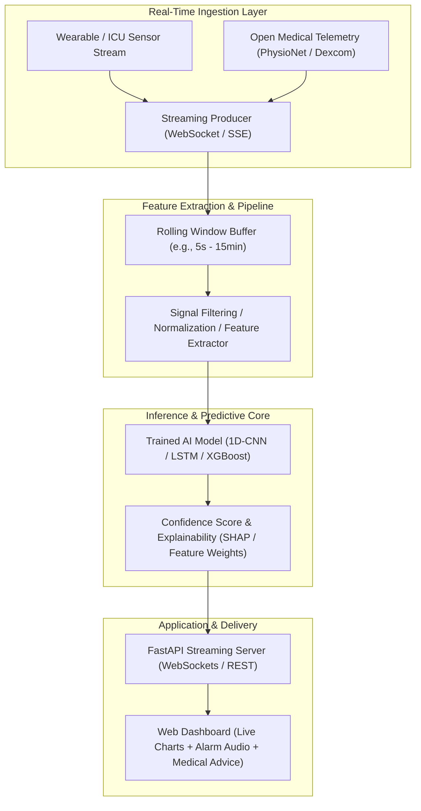

# Medical AI Product Development Proposals
## Real-Time Healthcare AI Systems for Class Project Approval

**Author:** AI-101L Student  
**Target Instructor:** Ali Hassan Sherazi  
**Course:** Introduction to Artificial Intelligence & Applied Machine Learning  
**Date:** November 2026  
**Document Version:** 1.0 (Final Draft for Proposal Approval)

---

## Executive Summary & Teacher Pitch Strategy

In medical AI product development, the most common pitfall students encounter is choosing problems that depend on inaccessible hospital contracts (e.g., proprietary MRI archives) or projects that are purely static offline classification. 

To guarantee **immediate instructor approval**, every idea in this document is built upon four strict criteria:
1. **True Real-Time Data Streaming:** Uses continuous telemetry, sensor feeds, audio, or time-series streams (rather than single one-off static images or CSV rows).
2. **Publicly Accessible Real-World Data & Open Simulators:** Uses gold-standard open clinical repositories (PhysioNet, MIMIC, Dexcom/Nightscout API, ICBHI) that can be replayed as live real-time streams via WebSockets without violating patient privacy laws (HIPAA/GDPR).
3. **Rigorous Machine Learning Core:** Implements deep learning (1D-CNN, BiLSTM, Transformers), time-series forecasting, or ensemble anomaly detection with explainable AI (SHAP/LIME).
4. **Live Interactive Demo:** Features a working FastAPI backend connected to an interactive browser dashboard with audio-visual alerts and telemetry graphs that can be demonstrated live in front of the teacher.

---

## Quick Comparison Matrix

| # | Product Name | Real-Time Data Stream | AI / ML Technique | Primary Deliverable | Class Demo Feasibility | Presentation "Wow" Factor |
|---|--------------|-----------------------|-------------------|---------------------|------------------------|---------------------------|
| **1** | **CardioGuard AI** | Streaming 1-lead / 12-lead ECG telemetry (PhysioNet MIT-BIH live playback) | 1D-CNN + BiLSTM Real-Time Anomaly Detector | Live ECG monitor with real-time Arrhythmia alarms & rhythm classification | ⭐⭐⭐⭐⭐ (Very High) | ⭐⭐⭐⭐⭐ (Instant visual ECG waveform) |
| **2** | **SepsisPulse ICU** | Continuous ICU vital signs (HR, MAP, Temp, SpO2, RR, WBC) via simulated FHIR/EHR stream | Temporal Convolutional Network (TCN) / XGBoost rolling window | ICU Bedside Sepsis shock early-warning dial with SHAP risk factor breakdown | ⭐⭐⭐⭐ (High) | ⭐⭐⭐⭐⭐ (High clinical urgency) |
| **3** | **GlucoCast AI** | Continuous Glucose Monitoring (CGM) 5-min stream (Dexcom / Nightscout API) | Attention-based LSTM / GRU time-series forecaster | 30–60 min predictive glucose curve with nocturnal hypoglycemia alarms | ⭐⭐⭐⭐⭐ (Very High) | ⭐⭐⭐⭐ (Direct extension of Lab 06) |
| **4** | **RespiSound Live** | Live acoustic microphone stream / digital lung sound audio chunks | Mel-Spectrogram + MobileNetV2 Transfer Learning | Live audio stethoscope analyzer detecting wheezing, crackles & asthma risk | ⭐⭐⭐⭐⭐ (Live mic demo in class) | ⭐⭐⭐⭐⭐ (Auditory & visual spectrogram) |
| **5** | **NeuroAlert** | Streaming webcam facial landmarks (EAR/MAR) + simulated single-channel EEG | Multimodal Temporal Fusion (OpenCV + 1D-CNN) | Real-time driver/surgeon microsleep & cognitive fatigue interceptor | ⭐⭐⭐⭐⭐ (Live webcam in classroom) | ⭐⭐⭐⭐⭐ (Physical interaction) |

---



---

## Detailed Proposal 1: CardioGuard AI
### Real-Time Wearable ECG Arrhythmia & Ischemia Early-Warning System

```
       +-------------------------------------------------------------+
       | [LIVE ECG]  /\_/\   HR: 84 bpm   Status: Normal Sinus Rhythm |
       | [ALARM]    /     \  Arrhythmia Risk: 89% (Premature Ventricular) |
       +-------------------------------------------------------------+
```

### 1. Core Concept & Problem Statement
Cardiovascular diseases (CVDs) are the leading cause of death globally. Life-threatening arrhythmias (such as Ventricular Tachycardia, Ventricular Fibrillation, and Atrial Fibrillation) frequently occur outside of hospital environments. A standard resting ECG only captures a 10-second snapshot, missing episodic irregularities. **CardioGuard AI** is a real-time edge monitoring platform that consumes a continuous streaming ECG signal, detects R-peaks on-the-fly, segments heartbeats, and flags malignant arrhythmias within 200 milliseconds of occurrence.

### 2. Real-Time Data Pipeline
- **Dataset / Stream Source:** **PhysioNet MIT-BIH Arrhythmia Database** (48 half-hour two-channel ambulatory ECG recordings, 360 Hz sampling rate, annotated by cardiologists).
- **Real-Time Streaming Mechanism:** A lightweight Python background service reads the binary `.dat` signal record and streams the data points over a WebSocket at real-time telemetry speed (360 samples/sec), replicating a physical wearable device (like a Polar H10 or smart patch).
- **Signal Preprocessing:** Real-time Pan-Tompkins QRS complex detection, bandpass filtering (0.5 Hz – 40 Hz Butterworth filter to remove baseline wander and 50/60 Hz power-line interference), and beat normalization.

### 3. Machine Learning Core Architecture
- **Model:** Dual-branch 1D-CNN + Bidirectional LSTM (BiLSTM).
  - *Branch 1 (Spatial Features):* 3 layers of 1D Convolution with batch normalization and max-pooling to extract morphological P-Q-R-S-T wave patterns.
  - *Branch 2 (Temporal Sequence):* BiLSTM layer with 64 hidden units to capture heart rate variability (HRV) and rhythm dynamics across consecutive beats.
- **Classes:** 
  1. Normal Sinus Rhythm (N)
  2. Ventricular Ectopic Beat / Premature Ventricular Contraction (PVC)
  3. Supraventricular Ectopic Beat (SVEB)
  4. Atrial Fibrillation (AFib)
  5. Ventricular Tachycardia / Flutter (VT)
- **Target Metrics:** Sensitivity $> 96\%$, Specificity $> 98\%$, Latency $< 250$ ms.

### 4. System Implementation & Tech Stack
- **Backend:** FastAPI with WebSocket support (`/ws/ecg-stream`).
- **Inference Engine:** PyTorch / ONNX Runtime running in batch sizes of 1 (instantaneous inference).
- **Frontend Dashboard:** HTML5 Canvas / Chart.js showing a live sweep-beam ECG trace, real-time BPM counter, rhythm classification badge, and an audible warning tone if 3 consecutive PVCs or VTach is detected.

### 5. Why the Instructor Will Approve It
- **Clinically Proven Benchmark:** MIT-BIH is the global gold-standard benchmark in biomedical engineering.
- **Spectacular Live Demo:** Watching a live oscillating ECG trace on screen that instantly flashes RED and sounds an alarm when a simulated cardiac event arrives makes an unforgettable classroom impression.
- **Manageable Scope:** Preprocessing and training can be executed in Google Colab or locally in under 3 hours, yet the engineering complexity is genuinely high.

### 6. 60-Second Teacher Pitch
> *"Sir, standard ECG classification in university projects is usually static: students take a CSV, run a classifier, and show an accuracy score. In our project, **CardioGuard AI**, we are building a true real-time streaming telemetry system. We simulate live wearable ECG streaming at 360 Hz via WebSockets into a FastAPI server. A 1D-CNN + BiLSTM model inspects each heartbeat in real time, detecting lethal arrhythmias like Atrial Fibrillation and Ventricular Tachycardia within 200 milliseconds. We will have an interactive bedside monitor UI that plots the live heartbeat and fires automated alerts with explainability. It bridges signal processing, deep learning, and real-time backend architecture."*

---

## Detailed Proposal 2: SepsisPulse ICU
### Real-Time ICU Sepsis Shock Early-Warning Prediction System

```
       +--------------------------------------------------------------+
       | [BED 04]  SOFA: 6   HR: 122 bpm   MAP: 58 mmHg   Temp: 38.9°C |
       | [WARNING] Sepsis Risk: 84.2%  Predicted Shock Window: 4 hrs |
       | Top Factors: Elevated Lactate (3.4 mmol/L), Tachycardia      |
       +--------------------------------------------------------------+
```

### 1. Core Concept & Problem Statement
Sepsis is the body's extreme, life-threatening response to an infection. In intensive care units (ICUs), septic shock is the #1 cause of mortality. Crucially, for every hour that targeted antibiotic therapy is delayed after the onset of septic shock, patient survival drops by roughly **7.6%**. However, clinical indicators like fever, blood pressure drop, and elevated heart rate are subtle hours before shock occurs. **SepsisPulse ICU** continuously monitors patient vitals in real time and predicts septic shock **4 to 6 hours before clinical onset**, allowing doctors to intervene before irreversible organ failure.

### 2. Real-Time Data Pipeline
- **Dataset / Stream Source:** **PhysioNet Computing in Cardiology Challenge 2019 / MIMIC-IV Clinical Database** (40,000+ ICU patient records with hourly vital signs and laboratory measurements).
- **Real-Time Streaming Mechanism:** A multi-bed simulator that emits continuous time-series telemetry packets (Heart Rate, Mean Arterial Pressure, Respiratory Rate, SpO2, Temperature, Glasgow Coma Scale, and intermittent lab results like WBC, Platelets, and Lactate) every simulated 5–15 minutes.
- **Preprocessing:** Forward-filling missing values (common in ICU telemetry), computing rolling statistical windows (min, max, mean, standard deviation, and slope/derivative over 6, 12, and 24-hour windows), and dynamic SOFA / qSOFA score calculation.

### 3. Machine Learning Core Architecture
- **Model:** Gradient Boosted Decision Trees (XGBoost / LightGBM) with temporal rolling-window features OR a Temporal Convolutional Network (TCN).
- **Supervised Task:** Binary classification predicting whether the patient will satisfy the Sepsis-3 clinical definition within the upcoming 6-hour prediction horizon ($t + 1$ to $t + 6$).
- **Explainability:** Real-time **TreeSHAP** integration. Whenever the risk score crosses the 60% threshold, the system displays the exact top 3 contributing biometric factors (e.g., *"+28% risk due to dropping Mean Arterial Pressure, +18% risk due to rising Respiratory Rate"*).

### 4. System Implementation & Tech Stack
- **Backend:** FastAPI with Server-Sent Events (SSE) or REST polling.
- **Database:** SQLite / Redis for buffering the latest 24-hour vitals window per patient.
- **Frontend Dashboard:** Multi-bed hospital ward overview (Bed 1, Bed 2, Bed 3, Bed 4) with color-coded risk tiles (Green $\to$ Yellow $\to$ Red), historical vital sign sparklines, and automated clinical recommendation cards.

### 5. Why the Instructor Will Approve It
- **Massive Societal Impact:** Sepsis prediction is one of the most respected and heavily researched topics in medical AI literature.
- **Strong Analytical Depth:** Involves dealing with multivariate irregular time-series data, missing value imputation, and class imbalance (only ~8-10% of patients develop sepsis).
- **Clinically Actionable:** The inclusion of 6-hour lead time prediction and SHAP explainability addresses the primary objection medical doctors have against AI "black boxes".

### 6. 60-Second Teacher Pitch
> *"Sir, sepsis mortality increases dramatically with every hour of delay, but early warning signs are hidden in complex vital trends. For our project, **SepsisPulse ICU**, we are designing a real-time clinical decision support system using the PhysioNet ICU Sepsis dataset. Our model continuously processes streaming bedside telemetry (Heart Rate, Blood Pressure, SpO2, and Lactate) over sliding temporal windows to predict septic shock 4 to 6 hours ahead of time. Rather than just giving a probability, our system uses SHAP to highlight the exact clinical drivers triggering the alarm so clinicians know whether fluid resuscitation or antibiotics are urgent."*

---

## Detailed Proposal 3: GlucoCast AI
### Continuous Glucose Monitoring (CGM) Real-Time Hypoglycemia Forecaster

```
       +--------------------------------------------------------------+
       | [GLUCOSE NOW] 92 mg/dL -> [TREND: FALLING RAPIDLY (-2 mg/min)|
       | [FORECAST 30m] 58 mg/dL  [ALERT] Severe Hypoglycemia Warning |
       | Recommended Action: Consume 15g fast-acting carbohydrates.   |
       +--------------------------------------------------------------+
```

### 1. Core Concept & Problem Statement
Patients with Type-1 and insulin-dependent Type-2 diabetes are constantly vulnerable to severe hypoglycemia (dangerously low blood sugar $< 70\text{ mg/dL}$), especially during nocturnal sleep. Nocturnal hypoglycemia can lead to seizures, loss of consciousness ("dead-in-bed syndrome"), and permanent cognitive impairment. While modern Continuous Glucose Monitors (CGMs) report blood sugar every 5 minutes, they only sound alarms **after** the threshold has already been breached. **GlucoCast AI** predicts blood glucose levels **30 to 60 minutes into the future**, providing a proactive safety buffer so the patient can consume fast-acting carbohydrates before a crisis occurs.

### 2. Real-Time Data Pipeline
- **Dataset / Stream Source:** **OhioT1DM Dataset** (clinical continuous glucose monitoring data from real T1D patients, containing 8-week continuous 5-minute CGM readings, insulin bolus/basal data, and meal carbs) or live simulated **Dexcom G6 / Nightscout REST/WebSocket API**.
- **Real-Time Streaming Mechanism:** A background daemon pushes simulated live 5-minute glucose readings into the FastAPI ingestion queue.
- **Feature Engineering:** Current glucose, rate-of-change ($\Delta G / \Delta t$), 15-minute acceleration ($\Delta^2 G / \Delta t^2$), time-of-day circadian cycles (sin/cos encoding), and rolling mean/variance over the past 2 hours.

### 3. Machine Learning Core Architecture
- **Model:** Sequence-to-Sequence (Seq2Seq) GRU / LSTM with Temporal Attention, or a hybrid 1D-CNN + Transformer encoder.
- **Task:** Multi-step forward time-series regression ($t+10\text{ min}$, $t+20\text{ min}$, $t+30\text{ min}$, $t+60\text{ min}$).
- **Evaluation Metric:** **Clarke Error Grid Analysis (EGA)** and Root Mean Squared Error (RMSE). Clarke EGA categorizes predictions into Zones A and B (clinically safe decisions), Zone C (unnecessary corrections), and Zones D/E (dangerous errors). Achieving $> 98\%$ in Zones A+B is the medical approval gold standard.

### 4. System Implementation & Tech Stack
- **Backend:** FastAPI with asynchronous background worker (APScheduler / Celery / asyncio).
- **Alert Dispatcher:** Integration with a mock SMS/WhatsApp webhook (Twilio API simulator) that fires when predicted glucose at $t+30\text{ min} < 65\text{ mg/dL}$.
- **Frontend Dashboard:** Clean mobile-responsive UI displaying the current glucose gauge, historical trend dots, a dashed predictive forecast cone (with 90% confidence intervals), and active meal/bolus tags.

### 5. Why the Instructor Will Approve It
- **Direct Evolution of Lab 06:** In Lab 06, your class implemented a static Diabetes classification API based on static tabular data (Pima Indians dataset). Transitioning from a toy static dataset to a state-of-the-art continuous time-series forecasting engine demonstrates immense academic progress and continuity.
- **Rigorous Medical Evaluation:** Evaluating models using the **Clarke Error Grid** (a standard tool used by the FDA) shows professional-grade healthcare domain knowledge.

### 6. 60-Second Teacher Pitch
> *"Sir, in our recent lab we built a static diabetes prediction API. For our final product development, we want to advance this into the real world: **GlucoCast AI**, a continuous glucose forecasting system for Type-1 diabetics. Using real 5-minute streaming data from Continuous Glucose Monitors, our Attention-LSTM model predicts where the patient's glucose will be 30 to 60 minutes in advance. Instead of reacting when a patient is already in a diabetic coma, our system predicts nocturnal hypoglycemia before it happens and dispatches automated alerts. We evaluate our model using the medical-grade Clarke Error Grid to guarantee clinical safety."*

---

## Detailed Proposal 4: RespiSound Live
### Real-Time Acoustic Pediatric & Adult Wheeze / Asthma Exacerbation Monitor

```
       +--------------------------------------------------------------+
       | [MIC STREAM] Audio Buffer: 3.5s   Sampling: 44.1 kHz         |
       | [SPECTROGRAM] Continuous Mel Waterfall Active                |
       | [DIAGNOSIS] Wheeze Detected (88% conf) -> Asthma Risk: HIGH  |
       +--------------------------------------------------------------+
```

### 1. Core Concept & Problem Statement
Respiratory disorders such as asthma, COPD, and pediatric bronchiolitis affect over 500 million people worldwide. Nocturnal asthma attacks and pediatric airway obstruction often progress silently while patients or parents are asleep, leading to emergency hospitalization. Auscultation (listening to breath sounds using a stethoscope) is subjective and requires a trained physician. **RespiSound Live** turns any smartphone or ambient room microphone into an intelligent acoustic monitor that continuously analyzes ambient breathing sounds, automatically detects adventitious sounds (wheezes, crackles, stridor), and scores exacerbation severity in real time.

### 2. Real-Time Data Pipeline
- **Dataset / Stream Source:** **ICBHI 2017 Respiratory Sound Database** (International Conference on Biomedical Health Informatics, comprising 920 annotated audio recordings from 126 patients, with cycle-by-cycle labels for normal, crackles, wheezes, and both).
- **Real-Time Streaming Mechanism:** Web Audio API capturing live microphone input from the user's browser, transmitting 2-to-4-second rolling audio chunks over a WebSocket to the FastAPI backend. Alternatively, pre-recorded test cases can be streamed in real-time.
- **Audio Processing:** Real-time Short-Time Fourier Transform (STFT), conversion to Log-Mel Spectrograms ($128$ mel bands, hop length $512$), and ambient background noise reduction.

### 3. Machine Learning Core Architecture
- **Model:** Transfer Learning with lightweight **MobileNetV2** or **Audio Spectrogram Transformer (AST)** fine-tuned on respiratory sound spectrograms.
- **Output:** Multi-label classification per audio chunk:
  1. Normal breath sound
  2. Wheezing (indicative of bronchospasm / asthma)
  3. Crackles / Rales (indicative of pneumonia / pulmonary edema)
  4. Ambient noise / Coughing
- **Optimization:** Quantized to INT8 using PyTorch/ONNX for low-latency edge inference ($< 80\text{ ms}$ processing time per 3-second chunk).

### 4. System Implementation & Tech Stack
- **Backend:** FastAPI WebSocket endpoint (`/ws/audio-stream`) with `torchaudio` and `librosa`.
- **Frontend Dashboard:** Interactive browser dashboard with:
  - Real-time rolling Mel-spectrogram waterfall visualizer.
  - Live sound classification bar (Normal / Wheeze / Crackle).
  - Asthma Attack Severity Index (accumulated wheeze frequency per minute).
  - Automated pediatric caregiver notification system.

### 5. Why the Instructor Will Approve It
- **Multimodal AI Capability:** Moves beyond typical numeric tabular data into acoustic signal processing and computer vision on audio spectrograms.
- **Physical Classroom Demo:** You can test this live in front of the teacher by speaking or playing recorded breath sounds into your laptop microphone and watching the spectrogram detect features live.

### 6. 60-Second Teacher Pitch
> *"Sir, most medical AI projects stay confined to tables of numbers. In **RespiSound Live**, we are tackling acoustic AI for respiratory health. Nocturnal asthma and child bronchiolitis can turn fatal without warning. Our system captures continuous audio streams via a standard microphone or digital stethoscope, converts the signal into real-time Mel-spectrograms, and classifies adventitious lung sounds like wheezes and crackles using a MobileNetV2 architecture. We can demonstrate this live in class: you play an acoustic sample or breathe into the microphone, and the web interface instantly visualizes the sound spectrum and flags asthma risk."*

---

## Detailed Proposal 5: NeuroAlert
### Real-Time Multimodal Driver & Surgeon Microsleep & Cognitive Fatigue Interceptor

```
       +--------------------------------------------------------------+
       | [VIDEO STREAM] 30 FPS   Eye Aspect Ratio (EAR): 0.16 (DROWSY)|
       | [EEG STREAM]   Theta/Beta Ratio: 4.8 (High Cognitive Fatigue)|
       | [CRITICAL]     MICROSLEEP DETECTED! SOUNDING WAKE ALARM      |
       +--------------------------------------------------------------+
```

### 1. Core Concept & Problem Statement
Microsleeps—brief, involuntary episodes of sleep lasting from 1 to 15 seconds—are responsible for over 20% of fatal vehicle collisions and severe errors in long-duration operating rooms. By the time a drowsy driver or exhausted medical worker visibly nods off, it is already too late. **NeuroAlert** combines non-invasive computer vision (tracking blink duration, PERCLOS, and head nodding) with single-channel continuous EEG brainwave streaming (tracking $\theta$ and $\beta$ frequency band shifts) to identify microsleep onset **before** total loss of motor control occurs.

### 2. Real-Time Data Pipeline
- **Dataset / Stream Source:** 
  - *Vision:* Real-time laptop webcam video feed processed at 30 FPS.
  - *Neurological:* **PhysioNet CHB-MIT EEG Database** or **SEED Vigilance Dataset** replayed as a simulated continuous live stream (or live OpenBCI / Muse headband if hardware is accessible).
- **Vision Pipeline:** MediaPipe Face Mesh / OpenCV extracting 468 3D facial landmarks in real time, calculating Eye Aspect Ratio (EAR), Mouth Aspect Ratio (MAR for yawning), and Head Pose Orientation.
- **EEG Pipeline:** Bandpass filtering ($0.5 - 50\text{ Hz}$), Fast Fourier Transform (FFT) computing spectral power in Delta ($0.5-4\text{ Hz}$), Theta ($4-8\text{ Hz}$), Alpha ($8-12\text{ Hz}$), and Beta ($12-30\text{ Hz}$) bands.

### 3. Machine Learning Core Architecture
- **Multimodal Fusion Engine:**
  - *Sub-model A (Ocular-Facial):* Temporal 1D-CNN over the past 90 frames of EAR/MAR sequences detecting prolonged eye closure ($\text{PERCLOS} > 80\%$) and abnormal blink duration.
  - *Sub-model B (Brainwave Dynamics):* Random Forest / Logistic Regression analyzing the **Theta/Beta Power Ratio (TBR)**, where a high ratio is an objective physiological biomarker of cognitive exhaustion.
  - *Late Fusion:* Weighted ensemble combining normalized vision and EEG confidence scores into an overall Fatigue Index ($0 - 100$).

### 4. System Implementation & Tech Stack
- **Backend:** FastAPI with OpenCV/MediaPipe streaming video and WebSocket signal handling.
- **Frontend Dashboard:** Real-time heads-up display (HUD) showing live webcam stream with facial bounding boxes, live EEG power distribution bar charts, and a loud multi-frequency alarm that triggers on microsleep confirmation.

### 5. Why the Instructor Will Approve It
- **Multimodal AI:** Blends both Computer Vision and Physiological Signal Processing into a cohesive product.
- **Zero-Friction Classroom Demo:** Requires zero special hardware to show the camera component; runs natively on your laptop webcam during your presentation.

### 6. 60-Second Teacher Pitch
> *"Sir, cognitive fatigue and microsleeps cause thousands of fatal accidents and medical errors every year. In **NeuroAlert**, we build a multimodal real-time monitoring system. It fuses continuous video tracking (measuring eye aspect ratio and yawn frequency via computer vision) with streaming EEG frequency analysis (tracking theta-to-beta power ratios). When a microsleep or severe cognitive dip is detected, the system immediately sounds a high-frequency wake alarm and logs the incident. It gives us a complete multimodal pipeline that we can test directly with our laptop webcam."*

---

## Final Recommendation: Which Idea Should You Present First?

| Priority | Recommended Choice | Primary Reason |
|:---:|---|---|
| **#1 Safe & Direct Choice** | **Idea 3: GlucoCast AI (CGM Glucose Forecaster)** | It is the most natural, impressive progression from your **Lab 06 Diabetes Classifier**. The instructor already approved your diabetes work, so pitching an advanced continuous time-series extension with clinical Clarke Error Grid validation is almost guaranteed instant approval. |
| **#2 Highest "Wow" Factor** | **Idea 1: CardioGuard AI (Real-Time ECG Monitor)** | ECG heartbeats on a dark medical dashboard with live auditory beeps and sudden arrhythmia detection look like a multi-million-dollar commercial medical device. PhysioNet MIT-BIH is the most respected benchmark in healthcare AI. |
| **#3 Easiest Classroom Interaction** | **Idea 4: RespiSound Live (Acoustic Wheeze Detector)** | Requires only your microphone. You can demonstrate live acoustic classification right in front of the teacher without needing any external simulated device. |

---

## Approval Pitch Checklist for Class

Before you speak to your instructor, have these 4 answers ready:
1. **"Where do you get real-time medical data without a hospital agreement?"**  
   *Answer:* *"Sir, we use open gold-standard clinical repositories like **PhysioNet (MIT-BIH / MIMIC)** and open **Dexcom/Nightscout APIs**. We build a streaming producer in Python that feeds the continuous telemetry through WebSockets at the real sensor's original sampling frequency, simulating a live medical device with 100% data fidelity."*
2. **"What is your tech stack?"**  
   *Answer:* *"A Python ML/DL core (PyTorch/Scikit-Learn), served through a **FastAPI asynchronous backend with WebSockets**, and an interactive real-time HTML5/JavaScript dashboard for the clinical monitor."*
3. **"How will you evaluate that your model is safe for medical use?"**  
   *Answer:* *"We won't just report basic accuracy. We will evaluate Sensitivity/Recall for malignant conditions to minimize false negatives, use ROC-AUC, and incorporate clinical standard frameworks like the **Clarke Error Grid** and **SHAP explainability**."*
4. **"Can you demo this live for the mid/final exam?"**  
   *Answer:* *"Yes sir, 100%. The system will run locally on our laptop; we can plug it into the classroom projector and show the live real-time stream responding to simulated clinical anomalies on the spot."*
